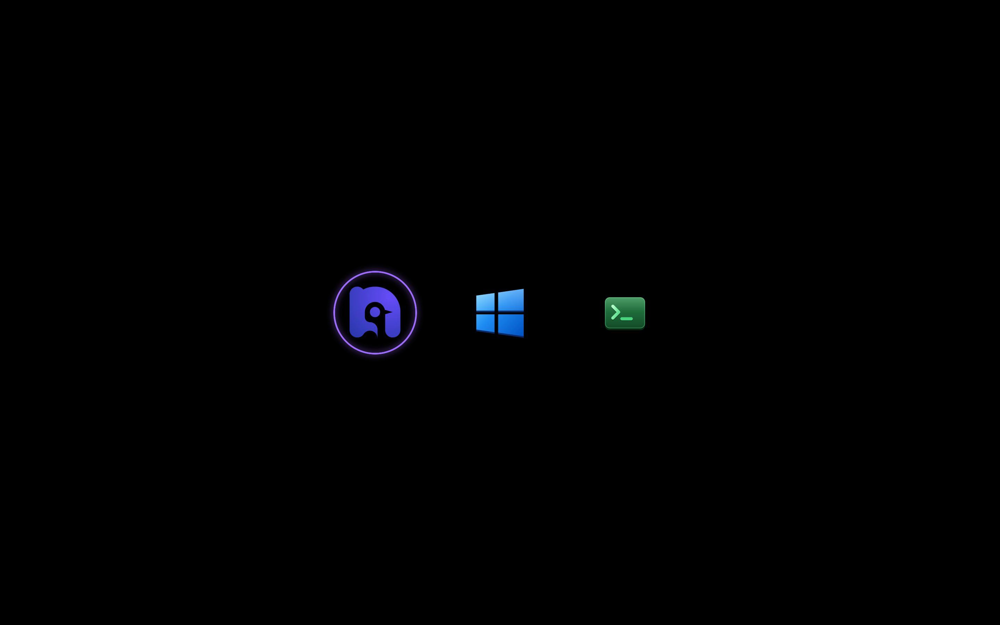

# nobara-rice

A dark, purple-accented **Nobara Linux + KDE Plasma 6** setup: a refined Nobara Plasma Style,
Geist fonts, candy icons, Catppuccin cursors, playful window effects, a matching Ghostty
terminal, and a themed **rEFInd** boot menu that sits in front of Nobara, Windows and GRUB.

This repo keeps the files that make up the look and the scripts to put them back.
It holds **only** appearance-related settings. No whole config folders, app data or credentials.

| | |
|---|---|
| **Distro** | Nobara Linux 44 (KDE Plasma Desktop Edition) |
| **Desktop** | KDE Plasma 6.7.4 on Wayland, KWin 6.7.4 |
| **Boot** | rEFInd 0.14.2 → Nobara (direct kernel boot) / Windows / GRUB fallback |
| **Terminal** | Ghostty 1.3.1 |

---

## Screenshots

| | |
|---|---|
|  |  |
| *Desktop — placeholder, add `screenshots/desktop.png`* | *rEFInd boot menu (rendered preview)* |

More placeholders to fill in: `screenshots/kickoff.png`, `screenshots/ghostty.png`,
`screenshots/lockscreen.png`. See [`screenshots/README.md`](screenshots/README.md).

---

## What's in the rice

### Look
| Part | Setting | Source |
|---|---|---|
| Global theme | Nobara (`org.nobaraproject.desktop`) | ships with Nobara |
| Plasma Style | **Nobara-Enhanced**, my own derivative of Nobara with rounder panel (6 px), popup (10 px) and snap-outline corners | [`kde/plasma-style/`](kde/plasma-style) |
| Colors | Nobara (stock, unmodified) | ships with Nobara |
| Application style | Breeze | ships with Plasma |
| Window decoration | Breeze: large buttons, left-aligned title, medium shadow, no outline, `HIAX` button order | [`kde/config/breezerc.ini`](kde/config/breezerc.ini) |
| Rounded window corners | KDE-Rounded-Corners effect, radius 10 | [matinlotfali/KDE-Rounded-Corners](https://github.com/matinlotfali/KDE-Rounded-Corners), built from source |
| Icons | candy-icons | `candy-icon-theme` package (or [EliverLara/candy-icons](https://github.com/EliverLara/candy-icons)) |
| Cursor | Catppuccin Mocha Mauve | [catppuccin/cursors](https://github.com/catppuccin/cursors) |
| Fonts | **Geist 11** (UI), Geist 9 (small), Geist 10 (titles), **Geist Mono 10** (fixed); slight hinting, RGB subpixel | `geist-font`, `geist-font-mono` (Terra) |
| Splash | Custom minimal splash (near-black + logo) | [`kde/splash/`](kde/splash) |
| Wallpapers | dark game screenshots (not included, copyrighted) | bring your own, see [`wallpapers/`](wallpapers) |
| Launcher icon | Gradient Nobara logo | [`assets/nobara-logo.png`](assets/nobara-logo.png) |

### Motion & effects
- Animation speed **0.75×** (a bit faster than default)
- **Ripple [Niri port]** window open/close animation, locally patched to skip Spectacle ([`kde/kwin/effects/`](kde/kwin/effects))
- **Magic Lamp** minimize, **Wobbly Windows**, **Translucency**
- Scale, Squash and Shake Cursor turned off
- Overview hot corner disabled; swiping down from the top edge (touch) locks the screen
- Night Light on, 4400 K

### Panels
- **Top bar** (36 px, dodge windows, translucent): launcher with Nobara logo · window title · spacer · media · system tray · weather · clock
- **Bottom dock** (50 px, floating, fit-to-content, translucent): pinned apps

### Terminal
- **Ghostty** with a custom `nobara-enhanced` palette (purple selection `#6C54AA`), 90% opacity + blur,
  font size 10, 5×5 padding, bar cursor, right-click paste ([`ghostty/`](ghostty))
- A KWin script + user service that reopens Ghostty at its last size/position
  ([`kde/kwin/scripts/`](kde/kwin/scripts))

### Boot
- **rEFInd** `nobara-purple` theme: black background, soft purple selection ring, no text clutter
  - gradient **purple Nobara** icon → direct EFI-stub kernel boot
  - **blue Windows** icon → Windows Boot Manager
  - **green GRUB** icon → shim/GRUB, kept as a fallback
  - older kernels and rescue entries folded into the submenu (F2 / Tab)
- GRUB itself uses the Catppuccin GRUB theme

### Input
- InputActions gesture: 4-finger horizontal swipe changes the volume ([`extras/inputactions/`](extras/inputactions))

---

## Repository layout

```
nobara-rice/
├── README.md
├── LICENSE                  MIT, for my original work only
├── LICENSING.md             what is covered by which license (read this)
├── LICENSES/                GPL-2.0-or-later, GPL-3.0 and OFL-1.1 texts for third-party parts
├── assets/                  nobara-logo.png (launcher, splash, rEFInd source)
├── docs/
│   ├── setup.md             step-by-step manual reproduction
│   └── audit.md             what was found on the source machine and where it lives
├── extras/inputactions/     touchpad gesture config
├── ghostty/                 config.ghostty + themes/nobara-enhanced
├── kde/
│   ├── config/*.ini         only the rice keys of kdeglobals, kwinrc, breezerc, …
│   ├── kwin/effects/        Ripple effect (MIT, patched)
│   ├── kwin/scripts/        ghostty-geometry KWin script + sync service
│   ├── panels/              layout.js (recreates panels) + sanitized reference
│   ├── plasma-style/        Nobara-Enhanced + tools/gen.py (regenerates the 3 changed SVGs)
│   └── splash/              custom splash package
├── refind/
│   ├── config/              refind.conf / refind_linux.conf templates (UUIDs as placeholders)
│   ├── theme/nobara-purple/ theme.conf, background, selection rings, font, icons
│   ├── src/                 scripts + SVGs that build the theme and icons
│   ├── install-refind-theme.sh
│   └── README.md            the full, careful rEFInd procedure
├── screenshots/
├── wallpapers/              README only; drop your own desktop.jpg / lockscreen.jpg here (git-ignored)
└── scripts/
    ├── install.sh           interactive, backs up everything it touches
    ├── backup.sh            refreshes this repo from the live system (read-only on the system)
    └── privacy-check.sh     scans the repo for personal data before you push
```

---

## Dependencies

| Package | Why | Where |
|---|---|---|
| `geist-font`, `geist-font-mono` | UI + monospace fonts | Terra (enabled on Nobara) |
| `candy-icon-theme` | icons | Nobara repo |
| `ghostty` | terminal | Nobara repo |
| `inputactions` | touchpad gestures (`kwin_gestures`) | Terra |
| Catppuccin cursors | cursor theme | GitHub release (installer downloads it) |
| KDE-Rounded-Corners | rounded window corners | build from source |
| Window Title Reborn | window title in the top bar | KDE Store (Get New Widgets) |
| `rEFInd`, `rEFInd-tools`, `rEFInd-unsigned-x64` | boot manager | Nobara repo |
| `ImageMagick`, `inkscape` | only for rebuilding the rEFInd theme | Fedora repos |

---

## Install

### Automated (user-level)

```bash
git clone https://github.com/<you>/nobara-rice.git
cd nobara-rice
scripts/install.sh --dry-run   # shows every action without changing anything
scripts/install.sh             # asks before each step
```

The installer:
- backs up every file or folder it changes to `~/.local/state/nobara-rice/backup-<timestamp>/`
- writes KDE settings **key by key** (your other settings stay as they are)
- asks before system-level steps (`sudo dnf`) and before rebuilding panels. Both default to **no**.
- **never** touches the bootloader

Log out and back in afterwards so fonts, the splash and KWin plugins all load.

### Manual
Follow [`docs/setup.md`](docs/setup.md). It covers every part, including the ones the script
leaves alone.

### rEFInd
Changing the boot manager is a separate, deliberate job. Read [`refind/README.md`](refind/README.md).
The helper `refind/install-refind-theme.sh` only copies theme files into an **existing** rEFInd
install. It runs as a dry run unless you pass `--apply`, and it never changes boot entries.

---

## Backup / restore

- **Refresh this repo from your live system:** `scripts/backup.sh` (try `--dry-run` first).
  It reads only known rice files, strips paths and UUIDs, and runs a privacy check at the end.
  Commit the result after reviewing `git diff`.
- **Undo an install:** copy files back from `~/.local/state/nobara-rice/backup-<timestamp>/`
  (same relative paths as in your home folder).
- **Before publishing:** run `scripts/privacy-check.sh`.

---

## Known limitations

- `kde/panels/layout.js` could **not be tested** without rebuilding the panels on the
  source machine. Panel opacity, "floating applets", tray hidden items and the weather location
  must be set by hand.
- No wallpapers are included (the originals are copyrighted game screenshots).
- Rounded corners and InputActions are compiled KWin plugins. They must match your exact KWin
  version and may need a rebuild after Plasma updates.
- The rEFInd config is specific to one dual-boot laptop (two ESPs, Btrfs root `subvol=@`).
  The templates contain `@UUID_n@` / `@ROOT_UUID@` placeholders you must fill in.
- rEFInd's icons and resolution were tuned for a 2880×1800 panel.
- `Xwayland` scale (1.6), display scaling and touchpad tuning are hardware-specific and not applied.

## Disclaimer

This is a personal setup shared as-is. Some hardware- and system-specific settings (display
scaling, disk UUIDs, partition layout, boot entries) **will** need adjustment on another machine.
Read the scripts before running them, and be especially careful with anything that touches the
EFI system partition. Keep a way to boot your system (for example, the firmware boot menu or a
live USB) before changing the boot manager.

## Credits

Nobara Project (base theme, logo artwork) · KDE · [Geist](https://github.com/vercel/geist-font) ·
[candy-icons](https://github.com/EliverLara/candy-icons) · [Catppuccin](https://github.com/catppuccin) ·
[kwin-niri-shaders-port](https://github.com/mj0x0/kwin-niri-shaders-port) ·
[KDE-Rounded-Corners](https://github.com/matinlotfali/KDE-Rounded-Corners) ·
[InputActions](https://github.com/InputActions/kwin) · [rEFInd](https://www.rodsbooks.com/refind/) ·
[Papirus](https://github.com/PapirusDevelopmentTeam/papirus-icon-theme) (Windows pane geometry) ·
[Window Title Reborn](https://github.com/ShrekBytes/window-title-reborn)

## License

This repository is **mixed-license**. See [`LICENSING.md`](LICENSING.md) for the file-by-file
breakdown.

- **My original work** (scripts, configuration, documentation, the splash code, my own rEFInd
  artwork) is released under the **[MIT License](LICENSE)**.
- **The Nobara-Enhanced Plasma Style** is a derivative of Nobara's Plasma Style and stays under
  **GPL-2.0-or-later** ([`kde/plasma-style/COPYING.md`](kde/plasma-style/COPYING.md)). It is
  **not** MIT.
- **Third-party code and assets** keep their own licenses: the Ripple effect (MIT, its
  authors), rEFInd's font (GPL-3.0-or-later / OFL-1.1), and the Papirus-derived Windows pane
  geometry (GPL-3.0).
- **The Nobara logo, the Windows logo and other third-party artwork or trademarks are not
  covered by my MIT license.** They remain the property of their respective owners and
  projects, and are included only to document and reproduce this personal setup.
