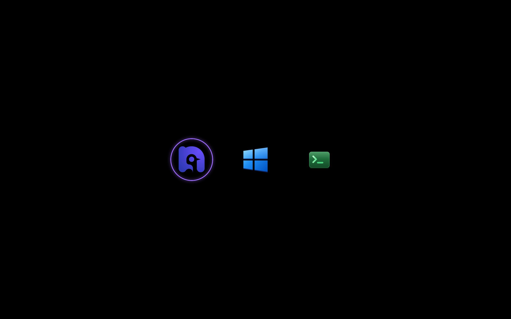

# rEFInd — `nobara-purple`

> **Machine-specific / legacy.** This documents the boot menu of the retired Nobara laptop (two ESPs,
> Btrfs `subvol=@`, Windows dual boot). It is **not** part of the CachyOS restore and `./install.sh` never
> touches it. Commands below use Fedora tooling (`dnf`, `grub2-*`); on Arch the package is `extra/refind`.

> ⚠️ **The boot manager is the riskiest part of this rice.** A mistake here can leave a machine
> that won't boot. Nothing in this repo changes boot entries automatically. Every step below
> is manual on purpose. Keep a live USB nearby and know how to open your firmware's boot menu.



## What the menu does

| Icon | Entry | How it boots |
|---|---|---|
| Purple gradient Nobara logo | **Nobara** (newest kernel, default) | rEFInd loads `vmlinuz` straight from `/boot` (ext4 driver) as an EFI stub, with options from `/boot/refind_linux.conf` |
| Blue Windows panes | **Windows** | auto-detected `EFI/Microsoft/Boot/bootmgfw.efi` |
| Green terminal | **GRUB** | manual entry that chains `EFI/fedora/shimx64.efi`, the same path the firmware "Fedora" entry uses. This is the fallback. |

- `fold_linux_kernels true` puts older kernels and `0-rescue` in the **F2 / Tab** submenu, so the main menu shows three icons.
- `dont_scan_*` lines hide duplicate loaders (fallback `BOOTX64.EFI`, raw shim/GRUB, the Windows fallback copy, a vendor recovery partition, memtest). This only affects what rEFInd shows. **No files are deleted.**
- `hideui hints,arrows,badges,label,…`: icons only. `timeout 12`. `resolution max`.
- Font: packaged `liberation-mono-regular-28.png`. The packaged `ubuntu-mono-28.png` in 0.14.2 is malformed and garbles submenu text.
- rEFInd 0.14.2 has no animation support.

## Files

```
config/refind.conf.template        -> <ESP>/EFI/refind/refind.conf
config/refind_linux.conf.template  -> /boot/refind_linux.conf
theme/nobara-purple/               -> <ESP>/EFI/refind/themes/nobara-purple/
src/                               scripts + SVGs that regenerate the theme (needs ImageMagick 7 + Inkscape)
install-refind-theme.sh            copies the theme only (dry run unless --apply)
```

### Placeholders in the templates

| Placeholder | Meaning on the source machine | Find yours with |
|---|---|---|
| `@ROOT_UUID@` | filesystem UUID of the Btrfs root (`/`, `subvol=@`) | `findmnt -no UUID /` |
| `@UUID_1@` | a vendor recovery partition to hide (`dont_scan_volumes`) | `lsblk -o NAME,PARTUUID,PARTLABEL,FSTYPE` |
| `@UUID_2@` | PARTUUID of the Nobara ESP (the one mounted at `/boot/efi`) | `findmnt -no PARTUUID /boot/efi` |
| `@UUID_3@` | PARTUUID of the Windows ESP (a separate partition on the source machine) | `lsblk -o NAME,PARTUUID,PARTLABEL` |

If your machine has only one ESP or no recovery partition, delete those tokens or the whole
line instead. Also copy any extra kernel arguments from `cat /proc/cmdline` into
`refind_linux.conf`. **If kernel arguments ever change (for example with `grubby`), update
`refind_linux.conf` to match.**

## Procedure used on the source machine (staged and reversible)

Run each step as root. Check the result before moving on.

**0. Back up.**
```bash
B=/var/backups/refind-$(date +%Y%m%d); sudo install -d -m 700 $B
sudo sh -c "efibootmgr -v > $B/efibootmgr-v.txt"
sudo tar -C /boot/efi -cpf $B/esp.tar .
```

**1. Install the package.** It does not touch the ESP by itself.
```bash
sudo dnf install rEFInd rEFInd-tools rEFInd-unsigned-x64
```

**2. Stage files on the Nobara ESP by hand.** Don't use `refind-install`, because it would also create an NVRAM entry.
```bash
R=/boot/efi/EFI/refind
sudo install -d -m 700 $R/drivers_x64 $R/icons
sudo install -m 700 /usr/share/rEFInd/refind/refind_x64.efi $R/
sudo install -m 700 /usr/share/rEFInd/refind/drivers_x64/ext4_x64.efi $R/drivers_x64/
sudo install -m 600 /usr/share/rEFInd/refind/icons/*.png $R/icons/
# fill the placeholders first, then:
sudo install -m 600 config/refind.conf.template $R/refind.conf
sudo install -m 644 config/refind_linux.conf.template /boot/refind_linux.conf
sudo refind/install-refind-theme.sh            # dry run
sudo refind/install-refind-theme.sh --apply
```

**3. Create a boot entry without changing the boot order, then test once.**
```bash
sudo efibootmgr --create-only -d /dev/nvme0n1 -p <ESP partition number> \
     -L rEFInd -l '\EFI\refind\refind_x64.efi'
sudo efibootmgr --bootnext <new entry number>    # one-time boot, then back to normal
```
Reboot. Check that Nobara, the submenu, the GRUB fallback and Windows all boot.

**4. Only when everything works, put rEFInd first.** Keep the old entries after it.
```bash
sudo efibootmgr --bootorder <rEFInd>,<Fedora/shim>,<Windows>,<fallback>
```

### Rollback
```bash
sudo efibootmgr --bootorder <previous order>   # the firmware boots GRUB again
sudo efibootmgr -b <rEFInd entry> -B           # delete the rEFInd entry
sudo rm -rf /boot/efi/EFI/refind /boot/refind_linux.conf
sudo dnf remove rEFInd rEFInd-tools rEFInd-unsigned-x64
```
Even without a rollback, the firmware boot menu (often F2/F10/F12 at power-on) still lists
the original "Fedora" (shim → GRUB) and "Windows Boot Manager" entries.

### Secure Boot
The source machine has Secure Boot **off**. rEFInd from the Fedora repos is not signed with a
key that shim trusts by default. With Secure Boot on, you would need to sign it with your
own MOK key, which this repo does not cover.

## Rebuilding the theme
```bash
cd refind/src
bash build-theme.sh        # writes ./nobara-purple/ (uses ../../assets/nobara-logo.png)
cp -r nobara-purple/* ../theme/nobara-purple/
```
`build-icons-v2.sh` draws the blue Windows icon (pane geometry from Papirus'
`distributor-logo-windows.svg`, which must be installed) and the green GRUB terminal icon
from the SVGs, and scales the Nobara logo to a 150 px glyph on a 256 px canvas.
The background is pure black at 2880×1800. Change the `magick -size` line for other panels.
